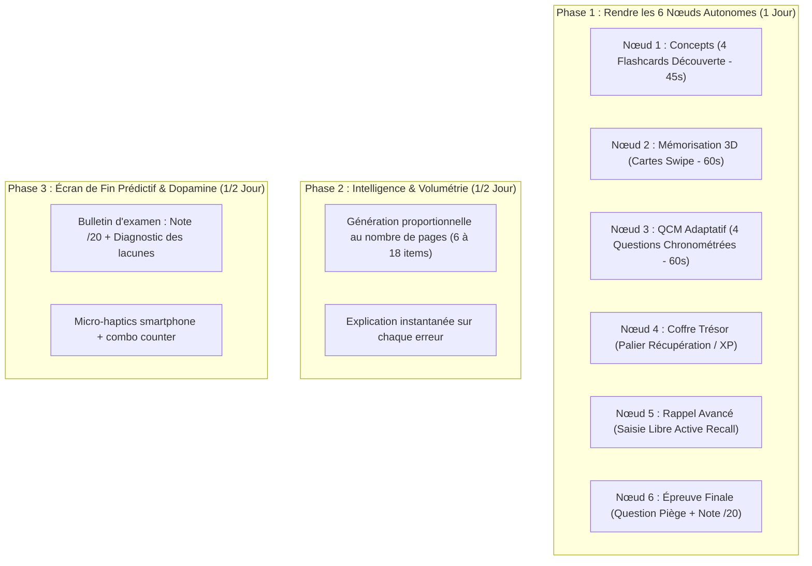

# 🔍 AUDIT SCEPTIQUE DE LORENO — ÉTAT DES LIEUX & PLAN CHIRURGICAL

> **Document de Référence & Analyse sans Complaisance**  
> *Date* : 6 Octobre 2026 | *Lead* : Julien Noel & Agent IA Antigravity  
> *Posture* : Scepticisme absolu, zéro biais d'optimisme, focus produit vs concurrence (Gizmo, Duolingo, TurboLearn).

---

## ⚖️ Le Verdict Brut : Sommes-nous loin du marché ?

### Réponse directe : **Non, ce n'est PAS un chantier titanesque de 6 mois.**
Mais **oui, il y a un décalage flagrant** entre ce que l'interface promet (un parcours Duolingo sophistiqué) et ce que le moteur livre réellement sous le capot (un player monolithique qui vide tout son contenu en une seule traite).

C'est ce décalage précis qui crée ton sentiment de flottement : **l'étudiant ne se sent pas guidé pas à pas, il a l'impression d'ouvrir un quiz en bloc déguisé en carte.**

---

## 🧱 1. Ce qui est VRAIMENT solide (Les Fondations Inébranlables)

Ces éléments fonctionnent parfaitement, sont testés, compilent en 0 erreur et n'ont pas besoin d'être refaits :

1. **L'infrastructure & Performance Next.js 16 App Router** :
   - Rendu hybride, compilation Turbopack rapide, aucun crash 500 en prod.
2. **La persistance de session Mobile (1 an)** :
   - Cookies SSR Supabase configurés (`maxAge: 31536000`, `SameSite: Lax`). Aucune déconnexion parasite sur Safari iOS ou Chrome.
3. **Le pipeline de Scan & Compression Client Canvas** :
   - Réduction des photos à < 400 Ko avant envoi réseau. Zéro timeout, upload instantané même en 4G.
4. **La qualité OCR & Synthèse Markdown (Gemini Flash)** :
   - Extraction fidèle, fiches de révision structurées avec définitions en gras, titres et points d'examen.
5. **Le tunnel de paiement & affiliation Stripe** :
   - Intégration live opérationnelle, gestion du parrainage avec réduction de 20% au panier pour le filleul.
6. **L'architecture du code** :
   - Zéro fichier > 300 lignes, typage TypeScript strict, zéro `any`, validation Zod systématique.

---

## ⚠️ 2. Ce qui cloche réellement (Les 4 Faiblesses Structurelles)

### Faiblesse n°1 : La Roadmap est une illusion visuelle (P0)
- **Le problème** : La carte affiche 6 nœuds Duolingo. Mais cliquer sur le Nœud 1, 2 ou 5 renvoie toujours vers `/review/[id]` qui charge **toutes** les questions en même temps. À la fin, la progression passe à 100%.
- **Ce que fait le marché (Gizmo, Duolingo)** : Chaque nœud est une **micro-session unitaire de 60 à 90 secondes**. On gagne de l'XP sur *ce* nœud, il se valide avec des étoiles, et le suivant se déverrouille.

### Faiblesse n°2 : Volumétrie IA uniforme et déconnectée du cours (P1)
- **Le problème** : Qu'un étudiant scanne 1 page ou 11 pages de médecine/droit, `/api/decks/generate-game` produit le même échantillon fixe de 5 cartes + 1 piège. Pour un partiel universitaire, 5 questions c'est un teaser, pas un outil de révision.
- **Ce que fait le marché** : Le volume d'entraînement est proportionnel à la densité de la matière (12 à 18 questions réparties équitablement sur les étapes du parcours).

### Faiblesse n°3 : Zéro diagnostic post-session (P1)
- **Le problème** : À la fin de la révision, l'app affiche un simple score sans valeur d'orientation. L'étudiant ne sait pas ce qu'il maîtrise et ce qu'il va rater à l'examen.
- **Ce que fait le marché** : Un **bulletin prédictif d'examen** :
  - *Note estimée au partiel : 14/20*
  - *Points forts : Les définitions constitutionnelles*
  - *Point faible critique : La chronologie des dissolutions (à revoir)*.

### Faiblesse n°4 : Manque de feedback sensoriel & dopamine (P2)
- **Le problème** : L'app est silencieuse et statique. Il manque les micro-retours haptiques (vibrations smartphone `navigator.vibrate`) et un retour sonore subtil lors des bonnes réponses.

---

## 🎯 3. Le Plan de Modularisation 80/20 (2 à 3 Jours d'Exécution)

Pour hisser Loreno au niveau des meilleurs SaaS d'apprentissage sans réécrire l'application :

---

## 📊 Estimation Réelle de l'Effort

| Chantier | Nature du Travail | Temps Estimé | Complexité |
|---|---|:---:|:---:|
| **Scinder le player par Nœud (`?step=1..6`)** | Filtrer la queue de `AdaptativeReviewPlayer` par étape | **4 heures** | Faible (Logique existante à découper) |
| **Génération proportionnelle multi-pages** | Adapter le prompt de `/api/decks/generate-game` | **2 heures** | Faible |
| **Bulletin d'examen prédictif (/20)** | Refonte de `ReviewCompletedModal` avec diagnostic | **3 heures** | Faible |
| **Explications instantanées sur les erreurs** | Ajout du champ `explanation` dans le feedback d'erreur | **2 heures** | Faible |
| **Micro-haptics & Combos** | `navigator.vibrate` + compteur de streak | **2 heures** | Très faible |

**Verdict** : Ce n'est pas une refonte. C'est un **découpage intelligent de ce qui est déjà codé** pour faire coïncider la promesse de la Roadmap avec l'expérience vécue par l'étudiant.
