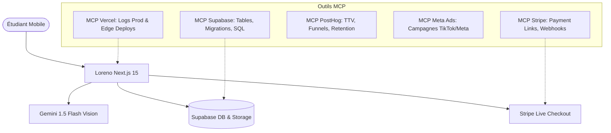

# 🤖 LORENO.APP — ARCHITECTURE AGENTIQUE & INTÉGRATIONS MCP

> **Guide d'Architecture Technique & Contrats d'Ingénierie pour Agents IA**  
> *Auteur* : Julien Noel & Agent Antigravity  
> *Version* : 1.0 (Octobre 2026)  
> *Périmètre* : Loreno.app (`locked-fouder-race`)

---

## 🎯 1. Principes Directeurs de l'Architecture Agentique

Pour qu'un agent IA (ou un binôme développeur + IA) puisse faire évoluer le projet à haute fréquence sans régressions :

1. **Règle Stricte des Fichiers < 300 Lignes (AGENTS.md)** :
   * Chaque composant UI ou utilitaire a une seule responsabilité claire.
   * L'arbre de composants est découpé en dossiers thématiques (`components/mirror/`, `components/review/`, `components/auth/`, `components/quiz/`).
   * Zéro bloc monolithique : un agent peut lire et réécrire n'importe quel fichier en un seul appel sans dépasser le budget de tokens ni tronquer du code.

2. **Zéro `any` & Typage Strict** :
   * Tous les payloads entrants sont validés côté runtime par **Zod** (`lib/validations.ts`).
   * Les types TypeScript sont inférés directement des schémas Zod (`z.infer<typeof schema>`).
   * Les fonctions exportées déclarent impérativement leurs types de retour.

3. **Séparation Stricte des Couches (80/20)** :
   * **UI Atoms & Organismes** (`components/*`) : Purement présentatifs avec état local ou callbacks.
   * **Validation & Contrats** (`lib/validations.ts`) : Schémas Zod partagés.
   * **Accès Données & Stockage** (`lib/supabase/*`) : Clients Supabase SSR (`server.ts`, `client.ts`, `storage.ts`).
   * **Route Handlers** (`app/api/*`) : Validation Zod $\to$ Auth check $\to$ Traitement Supabase/Gemini/Stripe $\to$ JSON standardisé `{ success: boolean, ... }`.

---

## 🔌 2. Matrice d'Intégration des Serveurs MCP

Loreno s'appuie sur un ensemble d'outils MCP pour superviser, tester et automatiser le cycle de vie produit :



### A. MCP Supabase
* **ID Projet** : `bfxbrveuwyiidfthevdn`
* **Tables Clés** :
  * `decks` : Cours scannés (titre, sujet, résumé, `image_url`, `image_urls`, `detailed_content`, `progress_percent`).
  * `flashcards` : Cartes mémoires associées (`deck_id`, `front`, `back`, `distractors`, `order_index`).
  * `user_referrals` : Programme d'affiliation cash (`user_id`, `referral_code`, `invited_count`, `balance_cents`, `iban`).
  * `payout_requests` : Demandes de virement bancaire des affiliés (seuil 70 €).
* **Storage** : Bucket public/privé `course-scans/${user.id}/${deckId}.jpg`.
* **Utilisation MCP** : Inspection de schémas, exécution de migrations SQL, diagnostic des index et RLS.

### B. MCP Stripe
* **Modèle** : Vente directe en Payment Link (`https://buy.stripe.com/aFa00idmx0iL8aV4gyds401`).
* **Webhook** : `/api/webhooks/stripe` recevant `checkout.session.completed`.
* **Action** : Activation instantanée du flag `is_pro: true` et attribution de 10 € / 100% de commission au parrain si un `client_reference_id` d'affiliation est présent.
* **Utilisation MCP** : Vérification des transactions réelles, gestion des coupons et suivi des remboursements/litiges.

### C. MCP PostHog & Analytics
* **Événements Clés Traqués** :
  * `scan_started` / `scan_completed` (Time-to-Value)
  * `flashcard_swipe` (left = fail, right = success)
  * `quiz_completed` (taux de complétion)
  * `paywall_viewed` / `paywall_clicked`
  * `referral_copied` / `referral_shared`

### D. MCP Meta Ads
* **Objectif** : Acquisition de trafic étudiant sur TikTok/Instagram Reels.
* **Pixel & Conversions** : Tracking `PageView`, `ViewContent` (scan), `InitiateCheckout` (clic bouton 9,99 €) et `Purchase`.

### E. MCP Vercel
* **Hébergement** : App Router Next.js 15 sur Edge / Serverless.
* **Utilisation MCP** : Surveillance des runtime logs `/api/scan` et `/api/decks`, alertes de latence ou quota Gemini.

---

## 📐 3. Matrice des Contrats Zod (`lib/validations.ts`)

| Point d'Entrée API | Schéma Zod | Champs Validés |
|---|---|---|
| `POST /api/scan` | `scanRequestSchema` | `base64`, `mimeType`, `imageUrl`, `images[]`, `cardCount` (3-15) |
| `POST /api/tutor` | `tutorRequestSchema` | `title`, `subject`, `summary`, `flashcards[]`, `messages[]` |
| `POST /api/decks` | `deckCreateSchema` | `title`, `subject`, `summary`, `detailed_content`, `progress_percent`, `flashcards[]`, `image_url` |
| `PATCH /api/decks` | `deckUpdateSchema` | `id` (UUID), `progress_percent` (0-100), `detailed_content` |
| `POST /api/decks/append` | `deckAppendSchema` | `deckId` (UUID), `images[]` (base64, mimeType) |
| `POST /api/decks/generate-game` | `deckGenerateGameSchema` | `deckId` (string/UUID) |
| `POST /api/referral` | `referralClaimSchema` | `refCode` (string 3-30 chars) |
| `POST /api/referral/payout` | `referralPayoutSchema` | `iban` (string min 10 chars) |
| `POST /api/feedback` | `feedbackRequestSchema` | `message` (min 3 chars), `rating` (1-5), `page` |
| `POST /api/auth/email` | `authEmailRequestSchema` | `email` (valid email), `onboarding` object |
| `POST /api/user/delete-account` | `deleteAccountRequestSchema` | `confirmText` ("SUPPRIMER") |

---

## 🗂️ 4. Arborescence Modulaire Assainie

```
app/
├── api/
│   ├── auth/email/
│   ├── decks/ (route.ts, append/, generate-game/)
│   ├── referral/ (route.ts, payout/)
│   ├── scan/
│   ├── tutor/
│   └── webhooks/stripe/
├── auth/
│   ├── login/page.tsx       (< 120L - Page d'auth principale)
│   ├── page.tsx             (< 50L - Redirection / alias propre)
│   └── callback/route.ts
├── dashboard/
├── review/[id]/
└── quiz/page.tsx            (< 160L - Orchestrateur d'onboarding)

components/
├── auth/                    (Modules d'authentification < 150L)
│   ├── otp-auth-form.tsx
│   ├── google-auth-button.tsx
│   └── retention-banner.tsx
├── mirror/                  (Visionneuse multi-documents < 150L)
│   ├── types.ts
│   ├── mirror-header.tsx
│   ├── mirror-banner.tsx
│   ├── mirror-doc-card.tsx
│   └── mirror-footer.tsx
├── mirror-modal.tsx         (< 120L - Orchestrateur assemblant mirror/*)
├── review/                  (Joueur de révision < 150L)
│   ├── review-types.ts
│   ├── review-progress-bar.tsx
│   ├── review-flashcard-step.tsx
│   ├── review-quiz-step.tsx
│   └── review-trap-step.tsx
├── AdaptativeReviewPlayer.tsx (< 160L - Coordinateur d'apprentissage)
├── quiz/                    (Étapes du quiz d'onboarding < 100L)
│   ├── quiz-choice-step.tsx
│   ├── quiz-name-step.tsx
│   └── quiz-email-step.tsx
└── quiz-steps-form.tsx      (< 100L - Assemblage des étapes)
```
