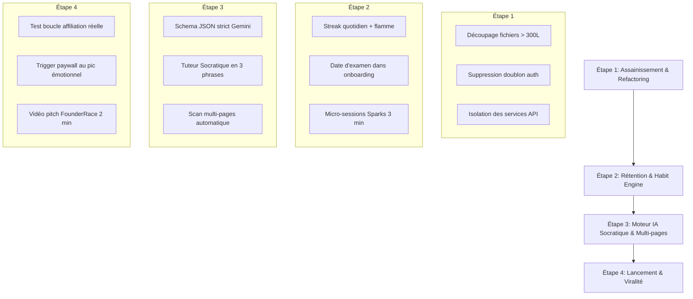

# 🧭 LORENO.APP — MÉGA AUDIT STRATÉGIQUE, PRODUIT & BLUEPRINT D'INGÉNIERIE

> **Document de Référence & Master Audit Produit**  
> *Destinataire* : Julien Noel (Lead Builder & Fondateur)  
> *Date* : Octobre 2026  
> *Périmètre* : Loreno.app (`\\wsl.localhost\Ubuntu\home\julien\git\locked-fouder-race`)  
> *Objectif* : Transformer le MVP 24h en machine B2C à forte rétention, inspirée des meilleurs du marché (Astra AI, Duolingo), tout en assainissant l'architecture pour un dev agentique ultra-rapide.

---

## 📊 1. Diagnostic Global & Score de Santé du Produit

| Dimension | Note | Verdict |
|---|:---:|---|
| **Vitesse d'Exécution & Time-to-Value (TTV)** | **9.5/10** | L'ingestion OCR et le flip 3D en < 2s constituent un avantage concurrentiel majeur (Wedge redoutable). |
| **Monétisation & Zero-Trust** | **9/10** | Verrouillage Stripe Webhook, Pack Fondateur agressif à 9,99 € et boucle d'affiliation cash très puissante. |
| **Activation Onboarding** | **7.5/10** | Bon tunnel, mais friction d'authentification encore présente (redondance pages auth) et pas d'ancrage par date de partiel. |
| **Rétention & Moteur d'Habitude (D1/D7/D30)** | **5.5/10** | Absence de boucle de retour passive (pas de streaks persistants, pas de notifications d'oubli SM-2, produit "à la demande" plutôt qu'habitudinaire). |
| **Architecture Code & Lisibilité Agentique** | **6.5/10** | Plusieurs composants dépassent les 300 lignes (jusqu'à 512 lignes), logique métier mélangée dans les composants UI, doublons d'auth. |
| **Intelligence Artificielle & Pédagogie** | **7.5/10** | OCR et fiches Markdown très propres, mais comportement IA "statique" (manque le mode socratique dynamique). |

---

## 🧠 2. Benchmark B2C AI SaaS : Leçons d'Astra AI ($25M ARR) & Duolingo

### A. La Règle d'Or de Duolingo : Remplacer l'"Éducation" par le "Sentiment de Progrès"
Les applications d'apprentissage qui échouent vendent des "cours". Celles qui scalent (Duolingo, Astra AI) vendent **l'évitement de l'échec et la dopamine du progrès visible**.
1. **Les Micro-Moments (5 à 10 minutes)** :
   * L'étudiant ne planifie pas une session de 2 heures. Il révise dans le bus, entre deux cours ou avant de dormir.
   * *Application pour Loreno* : Découper le cours scanné en "Sparks" de 3 minutes chrono plutôt qu'en une seule longue fiche exhaustive.
2. **L'Aversion à la Perte (The Streak Hook)** :
   * La flamme (Streak) est le levier de rétention numéro 1 au monde. Un étudiant qui a 7 jours de streak ne désinstalle jamais l'app.
   * *Application pour Loreno* : Introduire le Streak dès le 1er scan et le "Gel de Streak" (Streak Freeze) débloqué par le parrainage ou le Pro.
3. **L'Effet Zeigarnik** :
   * Le cerveau déteste laisser une jauge à 80%. Dès qu'un étudiant commence un set de flashcards, il doit voir une jauge de progression animée qui le force psychologiquement à terminer.

### B. Le Playbook d'Astra AI : Devenir le Compagnon d'Examen Central
Astra AI ne se positionne pas comme un simple "scanner de notes", mais comme le **seul endroit où l'étudiant prépare son partiel** :
1. **L'Ancrage par la Date d'Examen** :
   * Astra AI demande dès l'onboarding : *"Quelle est la date de ton prochain partiel ?"*. L'IA calcule alors : *"Il te reste 12 jours. Voici tes 3 missions du jour pour avoir 16/20"*.
2. **Le Mode Socratique (Pas juste donner la réponse)** :
   * Quand l'étudiant pose une question ou rate un quiz, l'IA ne crache pas un paragraphe de cours : elle pose une sous-question guidée pour lui faire trouver la solution lui-même.
3. **Multi-Modalités d'Entraînement** :
   * Fiche synthétique $\to$ Flashcards $\to$ Question piège $\to$ Simulation d'examen blanc en temps limité.

---

## 🎯 3. Audit Produit & UX/UI de Loreno

### Points Forts Actuels (Ne pas toucher) :
* **Shell Mobile 100dvh Lock** : Ergonomie parfaite pour TikTok/Reels, zone du pouce respectée.
* **Effet Miroir Multi-Photos** : Rassurer l'étudiant en lui permettant de comparer avec sa note manuscrite d'origine.
* **Parcours Gamifié `/review/[id]`** : La ré-injection des erreurs en fin de parcours (Option A) est exactement ce qui fait progresser l'élève.

### Points de Friction Critiques à Corriger :

#### 1. Friction d'Authentification & Redondance des Pages
* **Problème** : Il existe actuellement deux pages d'authentification concurrentes : `app/auth/page.tsx` (321 lignes) et `app/auth/login/page.tsx` (340 lignes).
* **Conséquence** : Confusion dans les redirections, doublon de code OTP, et risque de bug de session.
* **Solution 80/20** : Fusionner dans une route unique propre `/auth/login` (ou `/auth`) sous les 250 lignes.

#### 2. L'Offre et le Paywall (Timing de Monétisation)
* **Problème** : Afficher un bandeau violet "2 cours gratuits offerts" en permanence sur le dashboard banalise l'offre et réduit la valeur perçue.
* **Solution 80/20** :
  * Ne pas afficher un paywall passif permanent.
  * Déclencher le paywall **au pic émotionnel** :
    * Juste après avoir réussi une session de révision à 100% (*"Score de rétention : 95% ! Débloque le Mode Examen Prédictif"*).
    * Au moment d'ajouter le 3ème cours (limite atteinte).
  * Conserver le Pass Fondateur 9,99 € à vie (taux de conversion maximal pour les étudiants sans revenus récurrents).

#### 3. L'Onboarding "Sans But Précis"
* **Problème** : Le quiz demande le niveau (Lycée, PASS, Droit...) mais n'ancre pas l'urgence (pas de date d'épreuve ni de cible de note).
* **Solution 80/20** : Ajouter 1 écran ultra-visuel : *"Quand a lieu ton prochain examen/contrôle ?"* $\to$ Crée immédiatement un compte à rebours anxiogène-bénéfique (*"J-14 avant le partiel"*).

---

## 🤖 4. Audit Intelligence Artificielle & Prompts (Gemini)

### 1. Robustesse OCR & JSON Structuré
* **État Actuel** : Le prompt dans `app/api/scan/route.ts` demande du JSON brut via text prompting.
* **Risque** : Parfois, Gemini peut renvoyer du markdown englobant (```json ... ```) ou halluciner sur des écritures manuscrites quasi-illisibles.
* **Recommandation** :
  * Utiliser `responseMimeType: "application/json"` et `responseSchema` natif du SDK `@google/genai` pour garantir une validation de schéma 100% stricte côté Gemini.
  * Ajouter une consigne de transcription stricte : *"Si un mot est illisible, déduis-le par le contexte sémantique ou note-le [incertain], ne bloque jamais l'extraction"*.

### 2. Le Tuteur IA d'Examen (`/api/tutor`)
* **État Actuel** : Répond souvent avec de longs blocs de texte.
* **Recommandation** :
  * Limiter les réponses du tuteur à **3 phrases courtes maximum**.
  * Terminer **toujours** par une question pour relancer l'engagement (Principe de relance Socratique).

---

## 🏗️ 5. Audit Technique, Architecture & Lisibilité Agentique

### A. Non-Respect de la Règle des 300 Lignes (Dette Technique Majeure)
Plusieurs fichiers critiques sont devenus des "fichiers dieux" (God Components), difficiles à manipuler pour une IA sans risquer d'effacer du code :

| Fichier | Lignes Actuelles | Statut | Action Requise |
|---|:---:|:---:|---|
| `components/mirror-modal.tsx` | **512 lignes** | 🚨 Critique | Découper en : `MirrorHeader`, `MirrorImageGallery`, `MirrorControls`. |
| `components/AdaptativeReviewPlayer.tsx` | **365 lignes** | ⚠️ Élevé | Extraire les étapes : `FlashcardStep`, `QuizStep`, `TrapQuestionStep`. |
| `app/auth/login/page.tsx` | **340 lignes** | ⚠️ Élevé | Extraire `OtpCodeInput` et `GoogleAuthButton`. |
| `components/quiz-steps-form.tsx` | **339 lignes** | ⚠️ Élevé | Découper par étape d'onboarding. |
| `app/quiz/page.tsx` | **324 lignes** | ⚠️ Élevé | Séparer la logique d'état du conteneur visuel. |
| `app/auth/page.tsx` | **321 lignes** | 🚨 Doublon | À supprimer ou rediriger vers `/auth/login`. |

### B. Architecture pour l'Ingénierie Agentique (Travailler avec l'IA à 10x)
Pour qu'une IA code avec une précision chirurgicale sans casser le projet :
1. **Fichiers atomiques (< 200-250 lignes)** : Moins de tokens par requête $\to$ Moins de latence, zéro risque de troncature, compréhension parfaite du contexte.
2. **Séparation Stricte UI / Données** :
   * Pas de `fetch("/api/...")` direct au milieu d'un composant de bouton.
   * Centraliser les appels API dans un dossier `services/` (ex: `services/decks.service.ts`, `services/referral.service.ts`).
3. **Schémas Zod comme Source Unique de Vérité** :
   * Valider tous les payloads API avec Zod (`lib/validations.ts`) avant même de toucher Supabase.

---

## 🚀 6. Plan d'Action Recommandé (Ordre de Priorité 80/20)



### Phase 1 : Modularité & Propreté (Effort : Faible | Impact : Énorme pour la suite)
* Refactorer les 4 fichiers qui dépassent 300 lignes pour respecter la doctrine commando.
* Éliminer la redondance des deux pages `/auth`.

### Phase 2 : Rétention & Boucle d'Habitude (Inspiration Duolingo)
* Ajouter la notion de **Streak (Flamme de révision)** sur le Dashboard.
* Remplacer le bandeau d'offre statique par un déclencheur dynamique basé sur le score de rétention.

### Phase 3 : Polish IA (Inspiration Astra AI)
* Utiliser `responseSchema` strict pour Gemini Vision.
* Calibrer le Tuteur d'examen pour qu'il coache l'étudiant de manière interactive au lieu de faire des monologues.
